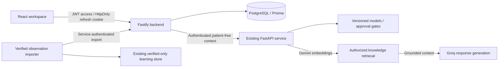

# RefHealth AI

Multi-hospital referral coordination with a React workspace, Fastify API, PostgreSQL database, and the existing Python intelligence service. Implementation follows the four phases in `full-prompt.md`; the older `prompt.md` describes the earlier AI-only phase.



The RefHealth AI Assistant uses Gemini for retrieval embeddings and Groq for final responses. The operational workflows run without AI availability. No real hospital data or production users are seeded. The existing synthetic models remain experimental; the application does **not** substitute them for approved real-data forecasts. See [implementation report](docs/implementation-report.md) for exact verification and outstanding dependencies.

## Local setup — Git Bash

Requirements: Node 22+, PostgreSQL 17+, Python compatible with the existing pinned model environment (tested here with Python 3.14). Use a PostgreSQL account/database dedicated to this application.

```bash
cd backend
cp .env.example .env
# Edit .env: PostgreSQL URL, a random JWT secret, matching AI service key.
npm ci
npm run generate
npm run migrate
# Set SEED_ADMIN_EMAIL and SEED_ADMIN_PASSWORD in .env first.
npm run seed
npm run dev
```

In another terminal:

```bash
cd ai-service
source venv/Scripts/activate
# If creating a new environment: python -m venv venv; pip install -r requirements-dev.txt
cp .env.example .env
# Set CORECARE_API_KEY to the backend AI_SERVICE_KEY.
# Set LLM_API_KEY and EMBEDDING_API_KEY in this server-side .env for the full assistant.
python -m uvicorn main:app --env-file .env --host 127.0.0.1 --port 8000
```

In a third terminal:

```bash
cd frontend
cp .env.example .env
npm ci
npm run dev
```

Open `http://127.0.0.1:5173`. The Vite proxy sends `/api` requests to port 3000. The backend's `CORS_ORIGIN` must match the browser origin. If Vite starts on port 5174 because 5173 is occupied, set `CORS_ADDITIONAL_ORIGINS=http://127.0.0.1:5174` in `backend/.env` and restart the backend. Both CORS and request-origin protection use these exact configured origins. Alternatively, start Vite with `npm run dev -- --port 5173 --strictPort` to fail rather than switch ports. The backend docs are at `http://127.0.0.1:3000/docs` and AI docs at `http://127.0.0.1:8000/docs`.

If port 8000 is occupied, choose another AI port and set the backend's `AI_SERVICE_URL` to that same address, then restart the backend.

Restart the AI service after changing its code, `.env` or dependencies. In an interactive development terminal, optionally add `--reload --reload-dir corecare`; changes elsewhere still require a restart. In a noninteractive Windows session, use an explicit restart: a reloader can stall while the old worker keeps serving requests. Wait for `Application startup complete` and verify an affected request, as the `/docs` title alone cannot prove new code is running. The assistant uses an 80-second provider budget, a 90-second backend timeout and a 100-second browser/proxy timeout; ordinary prediction requests retain their separate timeout.

## First workflow

1. Register two hospitals through the registration form using distinct registration numbers and administrator accounts.
2. Sign in as the seeded platform administrator and approve both registrations.
3. Sign in as each hospital administrator. Set its location coordinates, specialties, available services, capacity, and sharing choice.
4. Add healthcare workers. Grant `REFERRAL_RECEIVE` only to workers authorized to process incoming referrals.
5. At the sending hospital, register a patient, create a draft, request AI review, and select a destination explicitly.
6. At the destination, accept or reject the referral; then move accepted referrals through `IN_PROGRESS` and `COMPLETED`.
7. Record an observed outcome and have a hospital administrator verify it. Feedback on AI usefulness stays separate from verified outcomes.

Shared knowledge starts as a proposal. An authorized reviewer approves or rejects it. Conversations are private to their hospital and author. Approved sources become available to subsequent retrieval requests without a stale cache.

## Verification

See [testing instructions](docs/testing.md), [backend README](backend/README.md), [frontend README](frontend/README.md), and [AI platform integration](ai-service/docs/platform-integration.md).

## Deployment

See [deployment and troubleshooting](docs/deployment.md). Dockerfiles and Compose are provided, but container builds and hosted deployment were not executed in this Windows environment. Use HTTPS and a same-origin `/api` proxy in production for secure refresh cookies. Do not expose the AI service publicly without service authentication.
